# Taller de Observabilidad Básica de Microservicios con Spring Boot Actuator y Micrometer

* **Asignatura:** ELECTIVA I
* **Integrantes:**
  * **Carlos Mario Bechara Arias**
  * **Jose Daniel Zambrano Luna**
  * **Rafael Eduardo Sarmiento Peña**
* **Modalidad:** Práctica guiada / Laboratorio de Observabilidad
* **Tecnologías:** Java 21 LTS | Spring Boot 3.5.0 | Spring Boot Actuator | Micrometer | Apache Maven 3.9
* **Documentación Académica:** 📄 [`Informe_Taller_Observabilidad.pdf`](docs/Informe_Taller_Observabilidad.pdf)

---

## 1. Propósito y Resultados de Aprendizaje

El objetivo principal de esta práctica de laboratorio es:
1. Implementar dos microservicios REST independientes y desacoplados en el ecosistema **Spring Boot 3.5.0** con **Java 21 LTS**.
2. Establecer comunicación sincrónica HTTP entre microservicios empleando el cliente moderno y no bloqueante `RestClient`.
3. Instrumentar e inspeccionar la observabilidad en tiempo real a través de los endpoints de **Spring Boot Actuator** (`/actuator/health` y `/actuator/metrics`).
4. Monitorear métricas de rendimiento y latencia HTTP (`http.server.requests`) gestionadas por el motor dimensional **Micrometer**.
5. Evaluar los registros de log estructurados en consola para correlacionar eventos a lo largo del flujo de la solicitud.
6. Experimentar y analizar el impacto de fallos por indisponibilidad de dependencias downstream (parada de servicio remoto) y reflexionar sobre las limitaciones del chequeo de salud predeterminado.

---

## 2. Arquitectura de Microservicios

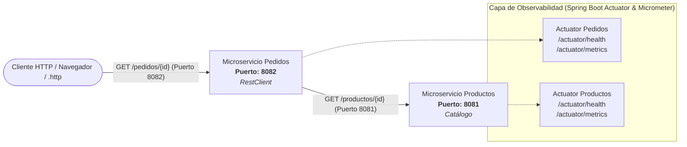

### Flujo de Interacción y Manejo de Resiliencia

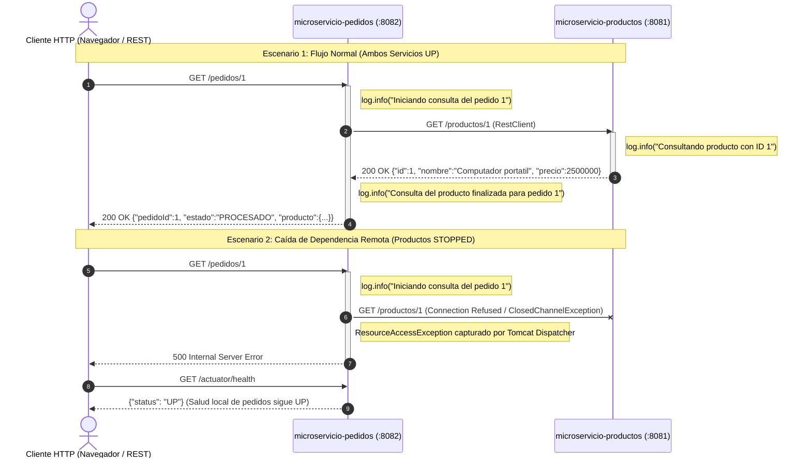

---

## 3. Estructura del Repositorio

El proyecto cuenta con un POM agregador raíz que coordina ambos microservicios como módulos Maven independientes, junto con las evidencias de ejecución y el informe técnico:

```text
observabilidad-microservicios-spring-boot/
├── pom.xml                                      # POM agregador raíz
├── README.md                                    # Documentación técnica completa y evidencias con capturas
├── docs/                                        # Documentación y evidencias formales
│   ├── Informe_Taller_Observabilidad.pdf        # Informe completo del taller en PDF
│   └── images/                                  # Capturas de pantalla reales de las pruebas
│       ├── 01_ejecucion_microservicio_productos.jpg
│       ├── 02_ejecucion_microservicio_pedidos.jpg
│       ├── 03_logs_consola_pedidos_productos.jpg
│       ├── 04_respuesta_pedidos_1_navegador.jpg
│       ├── 05_actuator_health_productos.jpg
│       ├── 06_actuator_health_pedidos.jpg
│       ├── 07_experimento1_metricas_pedidos_antes.jpg
│       ├── 08_experimento1_metricas_pedidos_despues.jpg
│       ├── 09_experimento1_metricas_productos_despues.jpg
│       ├── 10_experimento2_error_consola_caida_productos.jpg
│       └── 11_experimento2_actuator_health_pedidos_up.jpg
│
├── microservicio-productos/                     # MÓDULO 1: Catálogo de Productos (Puerto 8081)
│   ├── pom.xml                                  # Spring Boot 3.5.0 + Web + Actuator
│   └── src/main/
│       ├── java/com/ejemplo/productos/
│       │   ├── MicroservicioProductosApplication.java
│       │   └── controller/
│       │       └── ProductoController.java
│       └── resources/
│           └── application.properties          # server.port=8081, endpoints expuestos
│
└── microservicio-pedidos/                       # MÓDULO 2: Procesamiento de Pedidos (Puerto 8082)
    ├── pom.xml                                  # Spring Boot 3.5.0 + Web + Actuator
    ├── pruebas-observabilidad.http              # Script de pruebas HTTP para IntelliJ IDEA
    └── src/main/
        ├── java/com/ejemplo/pedidos/
        │   ├── MicroservicioPedidosApplication.java
        │   ├── RestClientConfig.java           # Bean Singleton de RestClient
        │   └── controller/
        │       └── PedidoController.java
        └── resources/
            └── application.properties          # server.port=8082, endpoints expuestos
```

---

## 4. Guía de Ejecución y Configuración

### 4.1 Requisitos de Entorno
* **Java Development Kit (JDK):** Versión 21 LTS (`java -version`).
* **Apache Maven:** Versión 3.9+ (`mvn -version`).
* **Puertos de Red:** `8081` (microservicio-productos) y `8082` (microservicio-pedidos).

### 4.2 Compilación del Proyecto
Desde la raíz del repositorio se pueden compilar y empaquetar ambos módulos en un solo paso:
```bash
mvn clean package -DskipTests
```

### 4.3 Puesta en Marcha

#### Opción 1: Desde IntelliJ IDEA / IDE compatible
1. Abrir el proyecto en el IDE.
2. Ejecutar la clase `MicroservicioProductosApplication` (puerto `8081`).
3. Ejecutar la clase `MicroservicioPedidosApplication` (puerto `8082`).

#### Opción 2: Desde terminales independientes
* **Terminal 1 (microservicio-productos):**
  ```bash
  cd microservicio-productos
  mvn spring-boot:run
  ```
* **Terminal 2 (microservicio-pedidos):**
  ```bash
  cd microservicio-pedidos
  mvn spring-boot:run
  ```

---

## 5. Pruebas Automatizadas con `pruebas-observabilidad.http`

El módulo `microservicio-pedidos` incluye el archivo `pruebas-observabilidad.http` listo para ser ejecutado directamente en el cliente HTTP de IntelliJ IDEA o VS Code:

```http
### 1. Consulta individual de Producto (directa al catálogo)
GET http://localhost:8081/productos/1

### 2. Consulta de Pedido (orquesta llamada interna a Productos)
GET http://localhost:8082/pedidos/1

### 3. Salud del microservicio de Productos
GET http://localhost:8081/actuator/health

### 4. Salud del microservicio de Pedidos
GET http://localhost:8082/actuator/health

### 5. Catálogo de métricas disponibles en Pedidos
GET http://localhost:8082/actuator/metrics

### 6. Métricas HTTP de solicitudes del servidor en Pedidos
GET http://localhost:8082/actuator/metrics/http.server.requests

### 7. Métricas HTTP filtradas por URI en Pedidos
GET http://localhost:8082/actuator/metrics/http.server.requests?tag=uri:/pedidos/{id}

### 8. Métricas HTTP de solicitudes del servidor en Productos
GET http://localhost:8081/actuator/metrics/http.server.requests

### 9. Métricas HTTP filtradas por URI en Productos
GET http://localhost:8081/actuator/metrics/http.server.requests?tag=uri:/productos/{id}
```

---

## 6. Evidencias de Ejecución y Resultados del Laboratorio

### 6.1 Ejecución Simultánea de Ambos Microservicios

Ambos microservicios fueron desplegados y ejecutados simultáneamente en IntelliJ IDEA bajo Java 21 LTS y Spring Boot 3.5.0:

* **`microservicio-productos`** levantado en el puerto `8081`:
  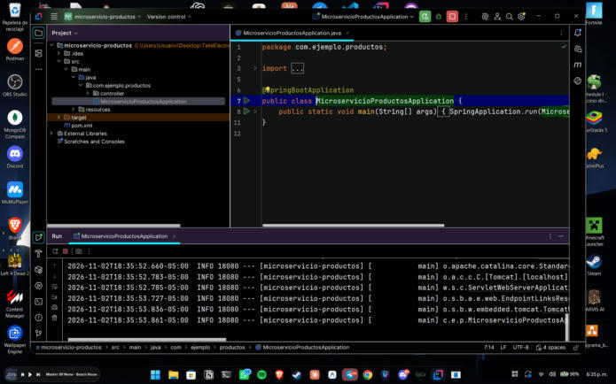

* **`microservicio-pedidos`** levantado en el puerto `8082`:
  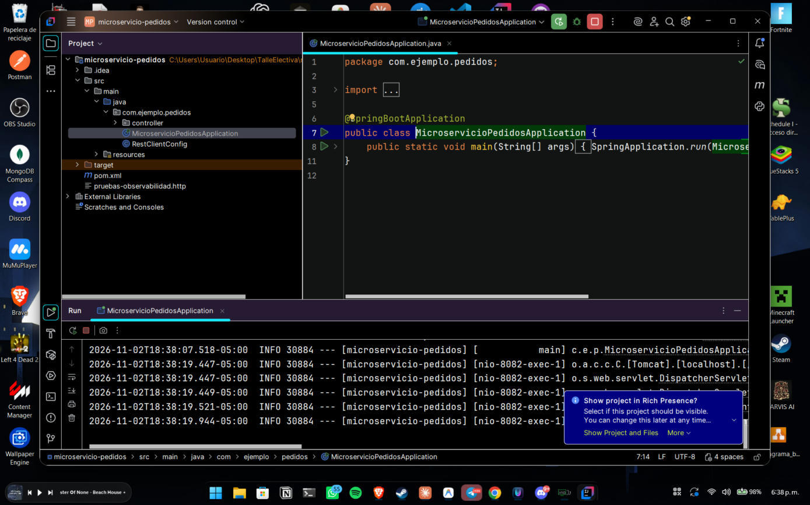

---

### 6.2 Respuesta de Negocio de `/pedidos/1` (HTTP 200 OK)

Al emitir la solicitud `GET http://localhost:8082/pedidos/1`, el microservicio de pedidos recibe la petición, invoca de manera transparente mediante `RestClient` al microservicio de productos (`http://localhost:8081/productos/1`), ensambla el payload consolidado y retorna código `200 OK`:

```json
{
  "pedidoId": 1,
  "producto": {
    "id": 1,
    "precio": 2500000,
    "nombre": "Computador portatil"
  },
  "estado": "PROCESADO"
}
```

#### Captura de la Respuesta en Navegador:
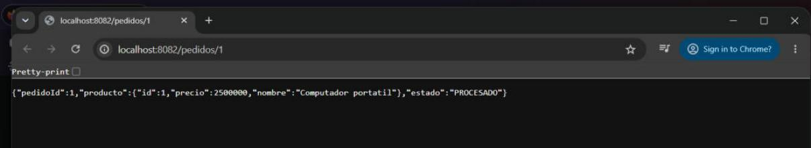

#### Trazabilidad mediante Logs en Consola:
Se constata en los registros de log el ciclo completo de la interacción distribuida:
```text
2026-11-02T18:38:19.521-05:00  INFO 30884 --- [microservicio-pedidos] [nio-8082-exec-1] c.e.pedidos.controller.PedidoController  : Iniciando consulta del pedido 1
2026-11-02T18:38:19.944-05:00  INFO 30884 --- [microservicio-pedidos] [nio-8082-exec-1] c.e.pedidos.controller.PedidoController  : Consulta del producto finalizada para pedido 1
```

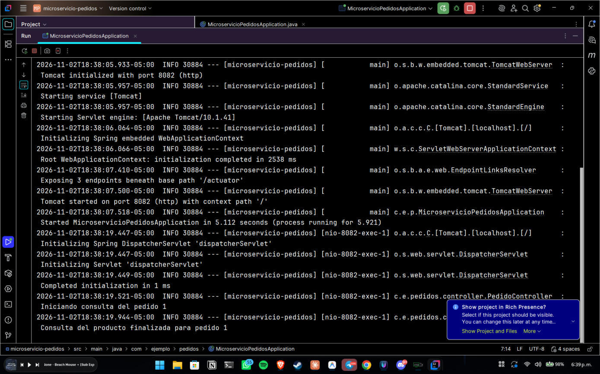

---

### 6.3 Indicadores de Salud (`/actuator/health`)

Ambos servicios devuelven estado `"status": "UP"` junto con el desglose de los subsistemas evaluados por defecto (espacio en disco, ping y soporte SSL):

#### Salud de `microservicio-productos` (Puerto 8081):
```json
{
  "status": "UP",
  "components": {
    "diskSpace": {
      "status": "UP",
      "details": {
        "total": 510937526272,
        "free": 41642422272,
        "threshold": 10485760,
        "path": "C:\\Users\\Usuario\\Desktop\\TalleElectiva\\microservicio-productos\\.",
        "exists": true
      }
    },
    "ping": {
      "status": "UP"
    },
    "ssl": {
      "status": "UP",
      "details": {
        "validChains": [],
        "invalidChains": []
      }
    }
  }
}
```
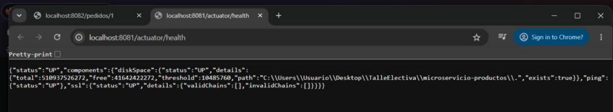

#### Salud de `microservicio-pedidos` (Puerto 8082):
```json
{
  "status": "UP",
  "components": {
    "diskSpace": {
      "status": "UP",
      "details": {
        "total": 510937526272,
        "free": 41598816256,
        "threshold": 10485760,
        "path": "C:\\Users\\Usuario\\Desktop\\TalleElectiva\\microservicio-pedidos\\.",
        "exists": true
      }
    },
    "ping": {
      "status": "UP"
    },
    "ssl": {
      "status": "UP",
      "details": {
        "validChains": [],
        "invalidChains": []
      }
    }
  }
}
```
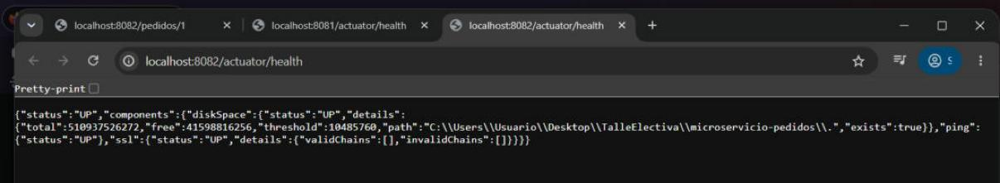

---

### 6.4 Experimento 1: Métricas de Solicitudes HTTP (`http.server.requests`)

Para este experimento, los tres valores provienen de una **misma sesión de ejecución en IntelliJ**, habiendo reiniciado el servicio de pedidos para asegurar que sus contadores iniciaran en cero, filtrando por la etiqueta `uri:/pedidos/{id}` en pedidos y `uri:/productos/{id}` en productos.

#### Tabla Comparativa de Mediciones Reales:

| Servicio / Endpoint | Momento de Medición | Peticiones (`COUNT`) | Tiempo Total (`TOTAL_TIME`) | Tiempo Máximo (`MAX`) | Tiempo Promedio Calculado (`TOTAL_TIME / COUNT`) |
| :--- | :--- | :---: | :---: | :---: | :---: |
| **Pedidos (:8082)** | **Antes:** 1 solicitud inicial | `1.0` | `0.1974 s` (197.4 ms) | `0.1974 s` (197.4 ms) | **197.4 ms** |
| **Pedidos (:8082)** | **Después:** 10 solicitudes adicionales | `11.0` | `0.2733 s` (273.3 ms) | `0.1974 s` (197.4 ms) | **24.8 ms** |
| **Productos (:8081)**| **Después:** Solicitudes acumuladas | `13.0*` | `0.1066 s` (106.6 ms) | `0.0818 s` (81.8 ms) | **8.2 ms** |

> **Nota sobre el contador de Productos (13):** `microservicio-productos` no se reinició entre pruebas, por lo cual acumuló 2 llamadas previas a la medición (una prueba directa de verificación y una consulta previa al reinicio de pedidos): $11 \text{ de pedidos} + 2 = 13$.

#### Capturas de las Mediciones de Métricas:

* **Métricas en Pedidos - Antes (1 petición inicial):**
  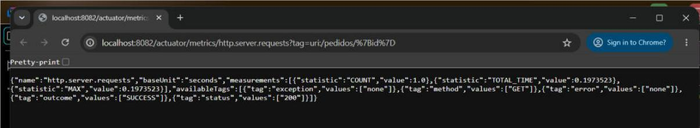

* **Métricas en Pedidos - Después (10 peticiones adicionales, 11 en total):**
  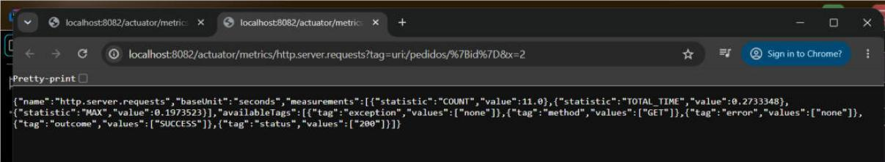

* **Métricas en Productos - Después (13 peticiones acumuladas):**
  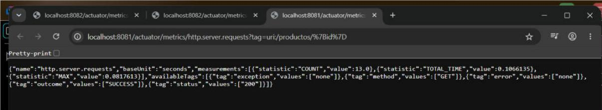

#### Interpretación Técnica de los Resultados:
1. **Registro Exacto de Solicitudes:** La métrica `COUNT` transitó con precisión de `1.0` a `11.0`, confirmando que las 10 peticiones subsiguientes fueron capturadas y contabilizadas por el Timer de Micrometer.
2. **Arranque en Frío (*Cold Start*) vs. Régimen Caliente (*Warm-up*):**
   * La primera solicitud demandó `0.1974 s` (~197 ms), debido a la carga de clases en la JVM, inicialización del motor de serialización Jackson, mapeo del `DispatcherServlet` y negociación TCP de la primera llamada vía `RestClient`.
   * El tiempo total (`TOTAL_TIME`) se elevó de `0.1974 s` a `0.2733 s`. Esto demuestra que las 10 solicitudes posteriores en conjunto consumieron apenas $\approx 0.076\text{ s}$ (es decir, **apenas ~7.6 ms por solicitud**).
3. **Comportamiento del Máximo (`MAX`):**
   * El valor `MAX` se conservó inalterado en `0.1974 s`. Esto sucede porque `MAX` almacena el valor pico dentro de la ventana temporal de decaimiento del medidor; al ser la primera petición la más lenta con diferencia, ninguna de las peticiones optimizadas en caliente superó dicho umbral.
4. **Evolución del Tiempo Promedio:**
   * La latencia media ($\frac{\text{TOTAL\_TIME}}{\text{COUNT}}$) descendió drásticamente de **197.4 ms** a **~24.8 ms** por el efecto de amortización del arranque inicial.
5. **Diferencial de Latencia entre Pedidos y Productos:**
   * La operación de `microservicio-pedidos` tarda sustancialmente más que la de `microservicio-productos` porque la primera incluye intrínsecamente la latencia de red de ida y vuelta (RTT), la serialización/deserialización HTTP y el procesamiento interno del servicio de catálogo.

---

### 6.5 Experimento 2: Simulación de Caída de la Dependencia Remota (`microservicio-productos`)

Se procedió a simular una falla de infraestructura deteniendo de forma controlada el proceso de `microservicio-productos` (puerto `8081`) mientras `microservicio-pedidos` (puerto `8082`) permanecía en funcionamiento.

#### Procedimiento y Respuestas Observadas:
1. Con `productos` detenido, se realizó la solicitud `GET http://localhost:8082/pedidos/1`.
2. El cliente recibió inmediatamente un código de respuesta **`HTTP 500 Internal Server Error`**.
3. En la consola de `microservicio-pedidos`, Spring Boot emitió un registro de error con la traza de excepción que evidencia la desconexión:
   ```text
   2026-11-02T18:41:59.895-05:00 ERROR 30884 --- [microservicio-pedidos] [nio-8082-exec-8] o.a.c.c.C.[.[.[/].[dispatcherServlet] : Servlet.service() for servlet [dispatcherServlet] in context with path [] threw exception [Request processing failed: org.springframework.web.client.ResourceAccessException: I/O error on GET request for "http://localhost:8081/productos/1": null] with root cause
   java.nio.channels.ClosedChannelException: null
   ```

   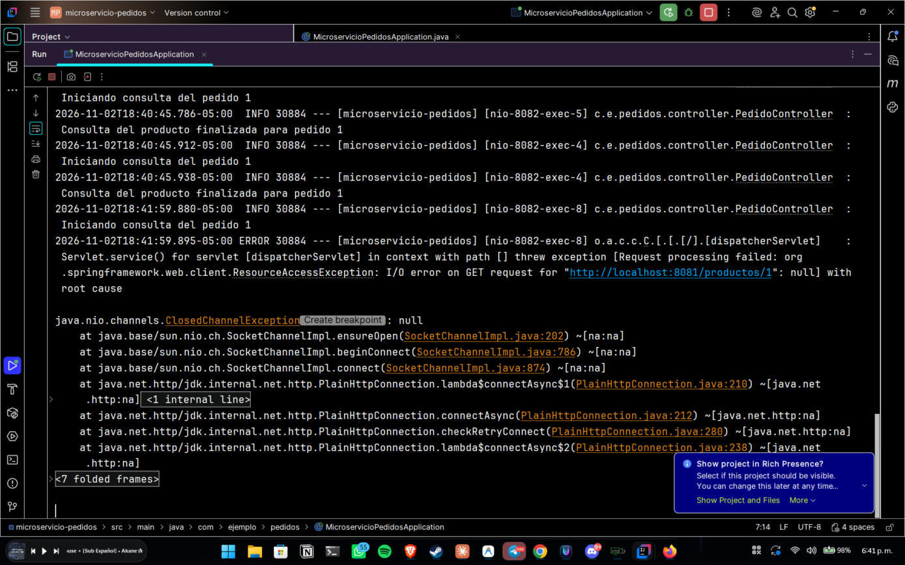

4. **Consulta de Salud durante el Fallo (`/actuator/health`):**
   Se consultó de inmediato el endpoint `http://localhost:8082/actuator/health` de pedidos. El servicio **siguió respondiendo `"status": "UP"`**:
   ```json
   {
     "status": "UP",
     "components": {
       "diskSpace": {
         "status": "UP"
       },
       "ping": {
         "status": "UP"
       },
       "ssl": {
         "status": "UP"
       }
     }
   }
   ```

   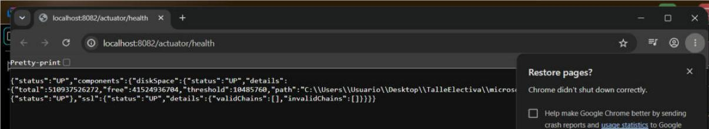

5. **Recuperación Automática:**
   Al volver a iniciar `microservicio-productos` en el puerto 8081, una nueva consulta a `GET /pedidos/1` respondió inmediatamente con código `200 OK` y estado `PROCESADO`, confirmando la auto-recuperación sin necesidad de reiniciar el microservicio de pedidos.

---

## 7. Preguntas de Análisis y Discusión Técnica

### 1. ¿Qué diferencia conceptual y práctica existe entre `COUNT` y `TOTAL_TIME`?
* **`COUNT` (Contador Acumulativo):** Es una métrica de tipo escalar que cuantifica cuántas peticiones han sido procesadas por el servidor para la combinación de tags (método, URI, estado HTTP).
* **`TOTAL_TIME` (Temporizador Sumatorio):** Es el tiempo acumulado (en segundos) empleado en procesar el conjunto total de peticiones registradas por `COUNT`.
* **Utilidad Práctica:** El cociente $\frac{\text{TOTAL\_TIME}}{\text{COUNT}}$ permite calcular la **latencia promedio** de las transacciones. En conjunto con la métrica complementaria `MAX`, permite diagnosticar si el rendimiento general del sistema es uniforme o si está distorsionado por valores atípicos (*outliers*) o penalizaciones de inicio en frío.

---

### 2. ¿Por qué el microservicio de pedidos permanece en estado `UP` si el microservicio de productos está detenido?
El endpoint `/actuator/health` predeterminado de Spring Boot únicamente audita **recursos locales del propio proceso**:
* `diskSpace`: Espacio libre en el almacenamiento del host local.
* `ping`: Estado y capacidad de respuesta del hilo principal del framework.
* `ssl`: Integridad de los certificados locales configurados.

Por defecto y por diseño deliberado, Actuator **no sondea de forma reactiva ni proactiva las dependencias HTTP remotas (*downstream*)**. En consecuencia, para Actuator el contenedor Tomcat y la JVM de pedidos continúan saludables a nivel de infraestructura, aunque funcionalmente cualquier operación de negocio que requiera comunicarse con el catálogo falle con error `500`.

> **Buenas Prácticas para Producción:** Para que la salud refleje la disponibilidad de dependencias, se debe implementar un `HealthIndicator` personalizado (que realice un ping rápido a productos) o incorporar patrones de tolerancia a fallos mediante librerías como **Resilience4j** (*Circuit Breaker*), las cuales degradan el estado del microservicio a `DOWN` o `DEGRADED` cuando se supera el umbral de fallos permitido.

---

### 3. ¿Qué datos de observabilidad permitirían detectar oportunamente una degradación del rendimiento antes de que el servicio colapse por completo?
1. **Deriva en Latencia Promedio y Percentiles:**
   * Incremento sostenido del tiempo promedio ($\frac{\text{TOTAL\_TIME}}{\text{COUNT}}$).
   * Elevación de los percentiles $p95$, $p99$ y del `MAX`, que revelan el retraso experimentado por las transacciones más pesadas antes de que afecte a la media.
2. **Métricas de Concurrencia y Saturación de Hilos:**
   * Aumento en las peticiones concurrentes activas (`http.server.requests.active`).
   * Saturación del pool de hilos de Tomcat (`tomcat.threads.busy` acercándose al límite configurado en `tomcat.threads.config.max`).
3. **Métricas de Recursos del Sistema Operativo y JVM:**
   * Utilización de CPU (`process.cpu.usage` y `system.cpu.usage`) por encima del 80%.
   * Incremento en la memoria Heap utilizada (`jvm.memory.used`) y frecuencia/duración anómala de pausas del recolector de basura (`jvm.gc.pause`).
4. **Tasa de Errores y Timeouts en Logs:**
   * Incremento en los tags `status: 5xx` o `outcome: SERVER_ERROR` en Actuator, y mayor frecuencia de excepciones de tipo `SocketTimeoutException` o `ResourceAccessException` en los logs consolidados.

---

### 4. ¿Qué aporta una traza distribuida (*Distributed Tracing*) que no proporciona el log individual de cada servicio?
En una arquitectura distribuida, los logs individuales son **eventos locales y fragmentados**: cada microservicio escribe sus mensajes en archivos separados, con sus propios formatos de marca de tiempo y sin ningún vínculo directo entre sí.

Una **traza distribuida** (mediante herramientas como **Micrometer Tracing**, **OpenTelemetry**, **Zipkin** o **Jaeger**) resuelve este aislamiento inyectando identificadores únicos en las cabeceras HTTP:
1. **`TraceId` Global:** Un identificador único que acompaña a la petición desde que entra por el cliente hasta que atraviesa todos los servicios intermedios y bases de datos. Permite filtrar los logs de toda la infraestructura con una sola consulta.
2. **`SpanId` de Segmento:** Identifica cada tramo individual de la llamada, permitiendo generar un diagrama de cascada (*waterfall*) que indica con precisión de milisegundos **dónde se consumió el tiempo o en qué salto exacto ocurrió la falla**.

---

### 5. ¿Qué riesgos críticos acarrea exponer `/actuator/metrics` y `/actuator/health` con desglose detallado en entornos de producción?
Exponer endpoints de Actuator con `show-details=always` de forma pública y sin mecanismos de autenticación expone al sistema a graves vectores de ataque:
1. **Divulgación de Información Sensible (*Information Disclosure*):**
   * Revela rutas absolutas del sistema de archivos en el servidor (`path: C:\Users\...`), estructura de carpetas, nombres de usuario del host y versiones exactas de librerías, dependencias y runtime de Java.
   * Expone detalles sobre el espacio en disco, estado de certificados SSL, variables de entorno y direcciones internas de red.
2. **Reconocimiento para Ataques Dirigidos (*Reconnaissance & DoS*):**
   * Facilita a un atacante identificar debilidades de memoria, picos de saturación de hilos y endpoints lentos para coordinar ataques de Denegación de Servicio (DoS) dirigidos.
3. **Mitigaciones Obligatorias para Producción:**
   * Desactivar el desglose público configurando `management.endpoint.health.show-details=when_authorized` o `never`.
   * Restringir el puerto de gestión a una interfaz de red interna no expuesta a internet (`management.server.port=8089`).
   * Proteger todos los endpoints `/actuator/**` mediante **Spring Security**, exigiendo autenticación basada en roles (`ROLE_ACTUATOR` / `ROLE_ADMIN`).

---

## 8. Conclusiones

1. **Los Tres Pilares de la Observabilidad:**
   * **Métricas:** Datos numéricos agregados a lo largo del tiempo (conteos, temporizadores, uso de memoria) que alertan oportunamente sobre anomalías de rendimiento.
   * **Logs:** Registros textuales puntuales que aportan contexto y detalle semántico para responder al *qué ocurrió* en un evento específico.
   * **Trazas:** El mapa correlacionado de ejecución de una petición a través de múltiples microservicios, imprescindible para determinar *dónde ocurrió el cuello de botella o la falla*.
2. **Limitaciones del Health Check Predeterminado:**
   * La verificación de salud estándar de Spring Boot Actuator únicamente garantiza que el proceso local está activo y cuenta con recursos básicos de máquina, pero no certifica la salud de los flujos de negocio dependientes de servicios remotos.
   * En sistemas de microservicios productivos, es indispensable complementar el monitoreo con métricas de cliente HTTP, indicadores de salud personalizados y patrones de resiliencia como *Circuit Breaker* y *Retry*.

---

*Taller desarrollado por **Carlos Mario Bechara Arias**, **Jose Daniel Zambrano Luna** y **Rafael Eduardo Sarmiento Peña** — ELECTIVA I*
