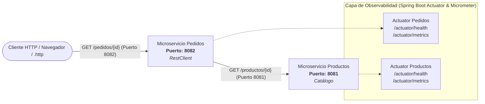
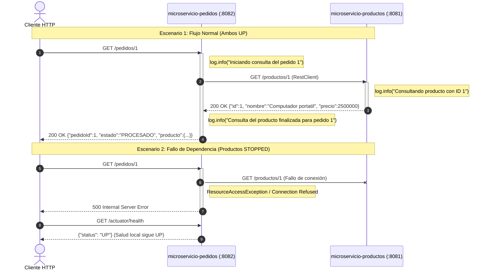

# Taller de Observabilidad Básica de Microservicios con Spring Boot Actuator y Micrometer

* **Asignatura:** Sistemas Distribuidos
* **Estudiante:** **JOSE DANIEL ZAMBRANO LUNA**
* **Modalidad:** Práctica guiada / Laboratorio de Observabilidad
* **Tecnologías:** Java 21 LTS | Spring Boot 3.4.1 | Spring Boot Actuator | Micrometer | Apache Maven 3.9

---

## 1. Propósito y Resultados de Aprendizaje

El objetivo de esta práctica es implementar dos microservicios REST independientes en Spring Boot, comunicar ambos servicios vía HTTP utilizando el cliente moderno `RestClient`, observar sus indicadores de salud (`/actuator/health`) y métricas HTTP (`/actuator/metrics`), examinar registros de log en consola y analizar el comportamiento y efecto de fallo ante la indisponibilidad de una dependencia remota.

---

## 2. Arquitectura de Microservicios



### Flujo de Interacción y Resiliencia



---

## 3. Estructura del Proyecto

El repositorio está organizado con un POM agregador raíz que gestiona ambos microservicios como módulos Maven independientes:

```text
observabilidad-microservicios-spring-boot/
├── pom.xml                                     # POM agregador raíz
├── README.md                                   # Documentación técnica completa y entregables
│
├── microservicio-productos/                    # MICROSERVICIO 1: Catálogo de Productos (Puerto 8081)
│   ├── pom.xml
│   └── src/
│       └── main/
│           ├── java/com/ejemplo/productos/
│           │   ├── MicroservicioProductosApplication.java
│           │   └── controller/
│           │       └── ProductoController.java
│           └── resources/
│               └── application.properties     # server.port=8081
│
└── microservicio-pedidos/                      # MICROSERVICIO 2: Gestión de Pedidos (Puerto 8082)
    ├── pom.xml
    ├── pruebas-observabilidad.http             # Archivo .http en el módulo según guía
    └── src/
        └── main/
            ├── java/com/ejemplo/pedidos/
            │   ├── MicroservicioPedidosApplication.java
            │   ├── RestClientConfig.java      # Configuración de RestClient Bean
            │   └── controller/
            │       └── PedidoController.java
            └── resources/
                └── application.properties     # server.port=8082
```

---

## 4. Guía de Ejecución y Configuración

### 4.1 Requisitos Previos
* **Java JDK:** 21 LTS (`java -version`).
* **Apache Maven:** 3.8+ o 3.9+ (`mvn -version`).
* **Puertos de Red Disponibles:** `8081` (Productos) y `8082` (Pedidos).

### 4.2 Compilación y Empaquetado
Desde la raíz del proyecto:
```bash
mvn clean package -DskipTests
```
Esto compila el código fuente con JDK 21 y genera los artefactos ejecutables `.jar` en los directorios `target/` de cada módulo.

### 4.3 Ejecución de los Servicios

#### Opción A (Desde el IDE - IntelliJ IDEA / VS Code):
1. Iniciar primero la clase principal `MicroservicioProductosApplication` (puerto `8081`).
2. Iniciar la clase principal `MicroservicioPedidosApplication` (puerto `8082`).

#### Opción B (Desde la terminal mediante Maven):
* **Terminal 1 (Productos):**
  ```bash
  cd microservicio-productos
  mvn spring-boot:run
  ```
* **Terminal 2 (Pedidos):**
  ```bash
  cd microservicio-pedidos
  mvn spring-boot:run
  ```

---

## 5. Pruebas con Archivo `.http` (IntelliJ IDEA)

El archivo `pruebas-observabilidad.http` contiene las solicitudes definidas en la sección 10 de la guía:

```http
### Producto
GET http://localhost:8081/productos/1

### Pedido
GET http://localhost:8082/pedidos/1

### Salud productos
GET http://localhost:8081/actuator/health

### Salud pedidos
GET http://localhost:8082/actuator/health

### Lista de métricas
GET http://localhost:8082/actuator/metrics

### Métricas HTTP pedidos
GET http://localhost:8082/actuator/metrics/http.server.requests

### Métricas HTTP productos
GET http://localhost:8081/actuator/metrics/http.server.requests
```

---

## 6. Evidencias de Ejecución y Resultados del Laboratorio (Entregables)

### 6.1 Ejecución Simultánea de Ambos Microservicios
Ambas aplicaciones iniciaron exitosamente en Tomcat embebido:
* **microservicio-productos:** Puerto `8081`, contexto `/`
* **microservicio-pedidos:** Puerto `8082`, contexto `/`

---

### 6.2 Respuesta JSON de `/pedidos/1`
Petición realizada al puerto `8082`, la cual consulta internamente a `microservicio-productos` (puerto `8081`) e integra el objeto anidado:

```json
{
  "pedidoId": 1,
  "producto": {
    "id": 1,
    "nombre": "Computador portatil",
    "precio": 2500000
  },
  "estado": "PROCESADO"
}
```

#### Registros de Log en Consola de Ambos Servicios:
* **Consola de microservicio-pedidos (8082):**
  ```text
  2026-10-27T12:35:28.458-05:00  INFO 22764 --- [microservicio-pedidos] [nio-8082-exec-1] c.e.pedidos.controller.PedidoController  : Iniciando consulta del pedido 1
  2026-10-27T12:35:28.807-05:00  INFO 22764 --- [microservicio-pedidos] [nio-8082-exec-1] c.e.pedidos.controller.PedidoController  : Consulta del producto finalizada para pedido 1
  ```
* **Consola de microservicio-productos (8081):**
  ```text
  2026-10-27T12:35:28.668-05:00  INFO 19500 --- [microservicio-productos] [nio-8081-exec-3] c.e.p.controller.ProductoController      : Consultando producto con ID 1
  ```

---

### 6.3 Indicadores de Salud (`/actuator/health`)

#### Salud de `microservicio-productos` (Puerto 8081):
```json
{
  "status": "UP",
  "components": {
    "diskSpace": {
      "status": "UP",
      "details": {
        "total": 509722226688,
        "free": 74788364288,
        "threshold": 10485760,
        "exists": true
      }
    },
    "ping": {
      "status": "UP"
    },
    "ssl": {
      "status": "UP"
    }
  }
}
```

#### Salud de `microservicio-pedidos` (Puerto 8082):
```json
{
  "status": "UP",
  "components": {
    "diskSpace": {
      "status": "UP",
      "details": {
        "total": 509722226688,
        "free": 74788028416,
        "threshold": 10485760,
        "exists": true
      }
    },
    "ping": {
      "status": "UP"
    },
    "ssl": {
      "status": "UP"
    }
  }
}
```

---

### 6.4 Experimento 1: Métricas de Solicitudes HTTP (`http.server.requests`)

Se consultaron las métricas HTTP antes y después de emitir una ráfaga de 10 peticiones adicionales a `/pedidos/1`:

#### Tabla Comparativa de Métricas (Filtradas por endpoint `/pedidos/{id}`):

| Momento de Medición | Peticiones (`COUNT`) | Tiempo Total (`TOTAL_TIME`) | Tiempo Máximo (`MAX`) | Latencia Promedio (`TOTAL_TIME / COUNT`) |
| :--- | :---: | :---: | :---: | :---: |
| **Petición Inicial (1 solicitud)** | `1.0` | `0.4395 s` (439.45 ms) | `0.4395 s` (439.45 ms) | `439.45 ms` |
| **Tras 10 solicitudes adicionales (11 en total)** | `11.0` | `0.5576 s` (557.59 ms) | `0.4395 s` (439.45 ms) | `50.69 ms` |
| **Diferencial (las 10 peticiones adicionales)** | `+10.0` | `+0.1181 s` (118.14 ms) | Inalterado | **`11.81 ms / petición`** |

#### Interpretación de las Métricas:
1. **Efecto de Arranque en Frío (*Cold Start*) e Inicialización JIT:** La primera petición registró un tiempo de `0.4395 s`, el cual se convirtió en el valor `MAX`. Esto ocurre debido a la carga inicial de clases en la JVM, la inicialización del `DispatcherServlet` y del cliente HTTP `RestClient`, y el handshake de la primera conexión TCP.
2. **Optimización en Caliente (*Warm-up*):** Las 10 peticiones subsiguientes se completaron en apenas `0.1181 s` combinadas, promediando apenas **11.81 milisegundos** por petición.
3. **Comportamiento del `MAX`:** `MAX` refleja el peor caso observado dentro de la ventana de decaimiento temporal del medidor de Micrometer. Como ninguna de las 10 peticiones posteriores superó la lentitud del arranque inicial, `MAX` permaneció anclado al valor de la primera solicitud (`0.4395 s`).

---

### 6.5 Experimento 2: Logs y Fallo de Dependencia Remota

#### Procedimiento Ejecutado:
1. Se detuvo únicamente `microservicio-productos` (puerto 8081).
2. Se envió una solicitud a `http://localhost:8082/pedidos/1`.

#### Resultado Observado:
* **Código de Respuesta HTTP:** `500 Internal Server Error`
* **Cuerpo JSON retornado al cliente:**
  ```json
  {
    "timestamp": "2026-10-27T17:36:49.357+00:00",
    "status": 500,
    "error": "Internal Server Error",
    "path": "/pedidos/1"
  }
  ```
* **Excepción registrada en la consola de `microservicio-pedidos`:**
  ```text
  org.springframework.web.client.ResourceAccessException: I/O error on GET request for "http://localhost:8081/productos/1": Connection refused: getsockopt
      at org.springframework.web.client.DefaultRestClient$DefaultRequestBodyUriSpec.exchangeInternal(DefaultRestClient.java:420)
      at org.springframework.web.client.DefaultRestClient$DefaultRequestBodyUriSpec.retrieve(DefaultRestClient.java:374)
      at com.ejemplo.pedidos.controller.PedidoController.consultar(PedidoController.java:27)
  ```
* **Consulta a `http://localhost:8082/actuator/health` durante el fallo:**
  ```json
  {
    "status": "UP"
  }
  ```
* **Recuperación:** Al reiniciar `microservicio-productos`, la consulta a `/pedidos/1` retornó inmediatamente el código `200 OK` con los datos del producto, demostrando recuperación del servicio.

---

## 7. Preguntas de Análisis (Sección 13)

### 23. ¿Qué diferencia existe entre COUNT y TOTAL_TIME?
* **`COUNT`:** Es un contador monotónico acumulativo que registra el número total de ejecuciones o eventos (en este caso, peticiones HTTP finalizadas) atendidas por el endpoint en la serie evaluada.
* **`TOTAL_TIME`:** Es la sumatoria acumulada de las duraciones temporales de todas las solicitudes contabilizadas por `COUNT`.
* **Aplicación:** Al calcular el cociente `TOTAL_TIME / COUNT`, se obtiene la **latencia media o tiempo promedio de respuesta**. Por su parte, la métrica complementaria `MAX` registra el tiempo de respuesta más alto observado dentro de la ventana del medidor.

---

### 24. ¿Por qué el servicio pedidos puede mostrar UP si productos está detenido?
El endpoint `/actuator/health` predeterminado de Spring Boot únicamente audita los componentes locales e internos del propio proceso (tales como la disponibilidad de memoria, espacio en disco y el estado del hilo principal a través del componente `ping`).

De forma deliberada y por diseño predeterminado, Spring Boot **no realiza chequeos activos contra las dependencias externas HTTP *downstream***. Por lo tanto, aunque la lógica de negocio falle con un error `500` debido a la ausencia del microservicio de productos, la infraestructura local de `microservicio-pedidos` sigue completamente operativa y en ejecución, manteniéndose en estado `UP`. Para reflejar la salud de dependencias remotas sería necesario implementar un `HealthIndicator` personalizado o integrar un *Circuit Breaker* (por ejemplo, con Resilience4j) que modifique el estado de salud a `DOWN` o `DEGRADED`.

---

### 25. ¿Qué datos de observabilidad permitirían detectar degradación de rendimiento?
1. **Percentiles de Latencia (p95, p99):** Más confiables que el promedio simple, pues revelan la degradación que experimenta el 5% o 1% más lento de los usuarios.
2. **Incremento en `MAX` y Deriva en `TOTAL_TIME / COUNT`:** Una elevación progresiva de la latencia promedio respecto a la línea base histórica.
3. **Métricas de Concurrencia y Encolamiento:** Un incremento en peticiones activas simultáneas (`http.server.requests.active`) sin un aumento proporcional en el caudal de salida (*throughput*), lo que evidencia acumulación o bloqueo en el hilo de procesamiento.
4. **Métricas de Recursos de la JVM y Sistema:**
   * Saturación de hilos del servidor Tomcat (`tomcat.threads.busy` cercano a `tomcat.threads.config.max`).
   * Aumento pronunciado en la utilización de CPU (`process.cpu.usage` y `system.cpu.usage`).
   * Frecuencia y duración prolongada de pausas del Garbage Collector (`jvm.gc.pause`).

---

### 26. ¿Qué aporta una traza distribuida que no proporciona el log individual de cada servicio?
Los logs individuales registran eventos aislados dentro de los límites de un único proceso o contenedor, con marcas de tiempo independientes y desvinculadas.

Una **traza distribuida** (*Distributed Tracing*, provista por herramientas como Micrometer Tracing, OpenTelemetry o Zipkin) inyecta identificadores globales únicos (`TraceId`) y de segmento (`SpanId`) en las cabeceras HTTP que viajan a lo largo de toda la cadena de llamadas entre microservicios. Esto aporta:
1. **Visibilidad Extremo a Extremo (*End-to-End*):** Permite reconstruir el viaje completo de una transacción desde que el cliente la origina hasta que interactúa con múltiples microservicios y bases de datos.
2. **Gráfico de Cascada (*Waterfall/Timeline*):** Permite ver con precisión de microsegundos cuánto tiempo consumió cada microservicio y dónde ocurrió el cuello de botella.
3. **Correlación de Logs Instantánea:** Permite filtrar los registros de todos los servidores utilizando un único `TraceId`, haciendo trivial identificar la causa raíz de una falla sin cruzar manualmente logs de múltiples servidores.

---

### 27. ¿Qué riesgos tiene exponer `/actuator/metrics` y `/actuator/health` con detalles en producción?
Exponer endpoints de Actuator con detalles (`show-details=always`) de forma pública y sin autenticación acarrea riesgos críticos de seguridad:
1. **Fuga de Información Sensible (*Information Disclosure*):** Los atacantes pueden inspeccionar rutas absolutas del sistema de archivos en el servidor (`path: C:\...`), versiones exactas de librerías y del runtime de Java, capacidades y espacio disponible en almacenamiento, detalles de infraestructura de red y certificados SSL.
2. **Vulnerabilidad a Ataques de Reconocimiento y DoS:** Conocer los nombres de todas las métricas, patrones de endpoints y consumo de memoria permite a un atacante diseñar ataques de denegación de servicio a la medida o explotar debilidades específicas de la infraestructura.
3. **Buenas Prácticas para Mitigación en Producción:**
   * Restringir el puerto de gestión a una red o subred privada no enrutable a internet (`management.server.port=...`).
   * Proteger el acceso a `/actuator/**` mediante Spring Security con autenticación y control de acceso basado en roles (`ROLE_ADMIN`).
   * Limitar los endpoints expuestos (`management.endpoints.web.exposure.include=health,info`).
   * Desactivar el desglose de detalles en entornos productivos (`management.endpoint.health.show-details=never` o `when_authorized`).

---

## 8. Conclusiones

* **Diferencia entre Métricas, Logs y Trazas (Los 3 Pilares de la Observabilidad):**
  * **Métricas:** Datos numéricos agregados a lo largo del tiempo (contadores, indicadores, temporizadores). Permiten alertamiento rápido y paneles de control (*dashboards*).
  * **Logs:** Mensajes discretos e informativos con contexto textual sobre eventos ocurridos en un instante determinado. Responden al *"qué pasó"*.
  * **Trazas:** Rutas y tiempos de ejecución a través de un ecosistema distribuido que vinculan peticiones entre diferentes servicios. Responden al *"dónde y por qué se demoró o falló"*.
* **Limitación del Health Predeterminado:** La salud predeterminada evalúa la disponibilidad del entorno del proceso pero no garantiza la conectividad ni el éxito funcional del negocio respecto a sus dependencias remotas. En arquitecturas de microservicios es imperativo complementarlo con instrumentación de clientes HTTP, *Circuit Breakers* e indicadores de salud personalizados.

---

*Desarrollado por Jose Daniel Zambrano Luna - Sistemas Distribuidos*
